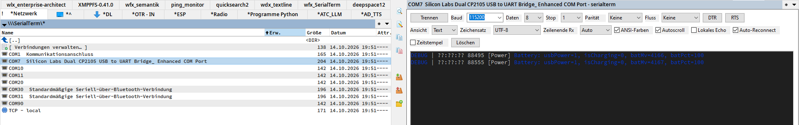
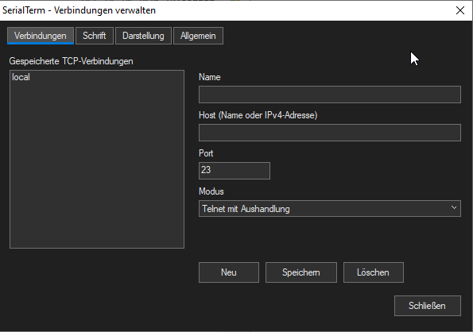

# MultiTerm

MultiTerm is a serial, TCP/Telnet, and SSH terminal for Total Commander on Windows. Open a COM port or a saved network connection in a separate terminal window, in Lister, or directly in the Quick View panel.

Serial and TCP/Telnet connections support text and hexadecimal output, ANSI colors, selectable character encoding, timestamps, and connection history. SSH uses an embedded PuTTYNG terminal. Both 32-bit and 64-bit Total Commander are supported.




## Installation

The supplied plugin files are:

- `MultiTerm.wfx` (32-bit)
- `MultiTerm.wfx64` (64-bit)

1. Place both files and the supplied `languages` folder together in a folder where you have write permission. For SSH, also place `PuTTYNG.exe` and `PuTTY-LICENCE.txt` in this folder.
2. In Total Commander, open **Configuration → Options → Plugins**.
3. Under **File system plugins (.WFX)**, choose **Configure → Add** and select `MultiTerm.wfx`.

64-bit Total Commander automatically uses `MultiTerm.wfx64`.

Open **Network Neighborhood** in Total Commander and select **MultiTerm**. You can now open terminals with **Enter**.

### Optional: enable F3 and Quick View

**Lister registration is not included and must be performed manually by the user.** To use **F3** and **Ctrl+Q**, create Lister copies of the supplied files:

1. In the same plugin folder, **copy** `MultiTerm.wfx` to `MultiTerm.wlx`.
2. **Copy** `MultiTerm.wfx64` to `MultiTerm.wlx64`. Keep the original WFX files as well.
3. Open **Configuration → Options → Plugins**.
4. Under **Lister plugins (.WLX)**, choose **Configure → Add** and select `MultiTerm.wlx`.

64-bit Total Commander automatically uses `MultiTerm.wlx64`. Keep all WFX and WLX files together so they share the same settings.

### Updating

When upgrading from SerialTerm, register `MultiTerm.wfx` under File system plugins and remove the old SerialTerm registration. If you use F3 or Quick View, create and register the new MultiTerm WLX copies as described above. Keep the new files in the same folder as your existing settings. Settings use `multiterm.ini`. If it does not exist, an existing `serialterm.ini` in the same folder is renamed automatically to `multiterm.ini`; after successful migration, the old filename no longer exists. An existing `multiterm.ini` always takes precedence.

Completely close Total Commander before replacing the supplied WFX files and updating the `languages` folder. If you enabled Lister support, recreate both WLX copies from the updated WFX files, replacing the previous copies. Then restart Total Commander. You only need to register the plugins once, provided their paths stay the same.

Already loaded plugins continue using the previous version until Total Commander is closed.

Keep `multiterm.ini` to preserve your settings and saved TCP/SSH connections. PuTTYNG can be updated independently by replacing its executable and accompanying licence.

## Getting started

The MultiTerm list contains:

| Entry | Purpose |
|---|---|
| `[ Manage connections… ]` | Manage saved TCP/SSH connections and configure terminal appearance. Press **Enter** to open it. |
| `COM7  Silicon Labs…` | An available serial port, with its device description. |
| `TCP - <name>` | A saved TCP or Telnet connection. |
| `SSH - <name>` | A direct SSH connection or a saved PuTTY profile; shown with a terminal-and-lock icon. |

The interface supports English, German, Ukrainian, and Russian. This guide uses the English labels.

### Connect to a serial device

1. Select its COM port and press **Alt+Enter** to open its properties.
2. Set the baud rate, data bits, stop bits, parity, and flow control required by your device.
3. Confirm with **OK**, then press **Enter** on the port to open the terminal.
4. Use **Connect** or **Disconnect** to control the connection.

The defaults are **115200 baud, 8 data bits, no parity, 1 stop bit**, no flow control, and DTR/RTS off.

### Add a TCP or Telnet connection

1. Open **Manage connections…**.
2. On the **Connections** tab, choose **New**.
3. Enter a name, host name or IPv4 address, and port number.
4. Choose **Raw (TCP)**, **Telnet with negotiation**, or **Telnet without negotiation (IAC filter)**.
5. Click **Save**, close the dialog, and open the new `TCP - <name>` entry.

You can edit or delete saved connections in the same dialog. **F8** on a TCP entry also deletes the saved connection. If the list does not refresh immediately, press **Ctrl+R**.

### Add an SSH connection

In **Manage connections… → Connections**, click **New**, enter a display name, and choose one of two SSH modes:

- **SSH (direct connection)**: enter the server's host name or IP address, port (default **22**), and optional **User name**. PuTTYNG asks for the password when connecting; if the user name is empty, it uses its defaults or asks for one. No saved PuTTY profile is required.
- **SSH (saved profile)**: choose the **SSH configuration source**, then select a profile from the editable **Saved SSH profile** list. The disabled port/user fields are ignored. You can also type an exact profile name.

Click **Save**, close the dialog, and open **SSH - <name>** with Enter, F3, or Quick View. Host-key confirmation and authentication are handled by PuTTYNG in both modes.

The **SSH configuration source** offers three choices:

| Source | Profiles and client |
|---|---|
| **Existing PuTTY profiles** | Reads SSH profiles from the current Windows user's PuTTY settings. The bundled PuTTYNG uses the selected profile directly. No import is needed. |
| **Existing KiTTY profiles** | Reads the existing KiTTY registry or portable session folder and starts that KiTTY executable, preserving its profile settings. It detects KiTTY from Windows App Paths, common installation folders, or PATH. |
| **Portable profiles (plugin folder)** | Reads `ssh_profiles.ini` beside the DLL and starts PuTTYNG with the profile's host, port, user name, and optional private key file. |

Create portable profiles on **Manage connections… → SSH profiles**: click **New**, enter the connection details, and click **Save**. Then select the profile on the **Connections** tab with **SSH (saved profile)** and the portable source. Relative private key paths are resolved against the profile file's folder. Copy the referenced key files separately when moving the configuration; the plugin does not copy or store passwords.

**Only the connection profiles are portable.** PuTTYNG's confirmed server host keys remain in the current Windows user's registry at `HKEY_CURRENT_USER\Software\SimonTatham\PuTTY\SshHostKeys`. The profile editor displays this location. These server fingerprints are not part of `ssh_profiles.ini`; a different Windows account/computer will ask you to verify the server again. PuTTYNG's other default terminal settings also remain in its normal Windows configuration.

On **SSH profiles**, you can set the **Existing KiTTY executable** and optional **KiTTY INI file** if automatic detection does not find your setup. Relative paths are resolved against the plugin folder. Leave the INI field empty to use KiTTY's existing configuration. Folder profiles include subfolders; Telnet profiles are excluded from the SSH selection. For KiTTY, host-key storage follows its own active registry or portable configuration. KiTTY may display its own authentication and error dialogs.

On **General**, **PuTTYNG executable** accepts an absolute path or a path relative to the plugin folder. The default is `PuTTYNG.exe` beside the plugin. The supplied PuTTYNG 0.85 executable requires 64-bit Windows and can be launched by either the 32-bit or 64-bit plugin on that system.

The selected SSH client handles the connection, host-key confirmation, authentication, keyboard input, and terminal display. MultiTerm does not store or pass passwords. Authentication can use PuTTY's normal prompts, keys, and Pageant.

SSH connections have separate **Connect automatically** and **Also connect in Quick View** options. **Connect** starts a new PuTTYNG process; **Disconnect**, closing the window, or changing the Quick View entry ends that window's client and SSH connection. Multiple SSH windows can run independently.

Fonts, colors, scrollback, and other SSH terminal preferences come from the selected PuTTY/KiTTY profile, or from the client's default settings for direct and portable profiles. MultiTerm's hex view, timestamps, counters, retained history, and automatic reconnection do not apply to the embedded SSH terminal. The unsupported history/reconnection options are disabled in SSH properties. Reconnect manually with **Connect**. After changing a connection's type or SSH settings, disconnect and connect again, or reopen its terminal.

Use **Paste** in the SSH toolbar to insert clipboard text through the client's own paste function. Right-click the upper toolbar/status area for a **Paste** context menu. In the PuTTYNG terminal itself, **Ctrl+right-click** opens its native context menu. The Paste button becomes available when the terminal is ready and is disabled after disconnecting.

PuTTYNG's terminal receives its own keystrokes. When its terminal has focus, some shortcuts belong to PuTTY; return focus to the TC file panel to use TC navigation shortcuts.

## Opening a terminal

| Key | Action |
|---|---|
| **Enter** | Open a separate terminal window. Serial/TCP entries share their terminal window; SSH entries open independent windows. |
| **F3** | Open the terminal in Total Commander's Lister window. |
| **Ctrl+Q** | Show the terminal in the Quick View panel. Selecting another entry switches the preview and disconnects the previous connection. |

Quick View activates the terminal input immediately for serial, TCP/Telnet, and SSH connections. For SSH, input becomes active when the client terminal is ready. Automatic connection still follows the entry's connection settings.
| **Alt+Enter** | Open the selected entry's properties. |

The management entry shows an empty preview when selected with F3 or Ctrl+Q. Use Enter to open its settings dialog.

### Automatic connection and reconnection

Each port or network connection has its own options in **Properties**:

- **Connect automatically (Enter, F3)**: connect automatically when opened with Enter or F3. Enabled by default.
- **Also connect in Quick View (Ctrl+Q)**: also connect automatically in Quick View. Enabled by default for serial, TCP/Telnet, and SSH connections; requires **Connect automatically**. Existing saved choices are preserved.
- **Reconnect automatically after connection loss**: reconnect after the connection is lost (serial/TCP only).

When automatic connection is disabled, click **Connect** to start the connection. Automatic reconnection waits until you do so. Clicking **Disconnect** stops automatic reconnection until you connect again.

Changes to an entry's properties apply immediately to its open separate terminal window. Reopen an existing F3 or Quick View terminal to use changed properties.

## Using the terminal

The following controls apply to serial and TCP/Telnet connections. For SSH, type directly into the PuTTYNG terminal.

Type into the input field and press **Enter**, or click **Send**. Choose the outgoing line ending beside the input field: none, CR, LF, or CR+LF.

| Control | Purpose |
|---|---|
| **View** | Switch between Text and Hex output. |
| **Encoding** | Select UTF-8, Latin-1/CP1252, or ASCII. |
| **Rx line ending** | Select received line endings: Auto, CR+LF, LF, or CR. Auto recognizes all three forms. |
| **ANSI colors** | Enable colors supplied by the connected device. Disable for uniform text color. |
| **Autoscroll** | Follow incoming output. Scrolling up pauses it; scrolling to the bottom resumes it. |
| **Local echo** | Display sent text locally. Negotiated Telnet server echo suppresses local echo to avoid duplicates. |
| **Auto-reconnect** | Enable automatic reconnection after connection loss. |
| **Timestamps** | Show local arrival times before text lines, including retained output. |
| **Clear** | Clear the displayed output and its retained data. |

Serial settings can also be changed in the terminal toolbar. DTR and RTS switches are available unless their line is controlled by the selected hardware flow control.

The status area shows the connection state and received/sent byte counts. For serial connections, it also displays CTS, DSR, RI, and DCD signals.

### Selection and keyboard shortcuts

- Drag across output to select text; **Ctrl+C** copies the selection and **Ctrl+A** selects all output when the output area has focus.
- Right-click the output for Copy, Select all, and Clear output.
- In the input field, **Up/Down** recalls previously sent lines.
- In the output area, **Page Up/Page Down** scrolls; **Ctrl+Home/Ctrl+End** jumps to the beginning/end.
- **Ctrl+Q** toggles Quick View. If it does not respond while editing the baud rate, move the focus to the input or output area first.
- Close an F3 terminal with its window's close button; Esc does not close it.

## Fonts, colors, and hexadecimal output

Open **Manage connections…** with Enter, or select **MultiTerm** in Network Neighborhood and press **Alt+Enter** (Properties). Font and Appearance settings apply to all serial and TCP terminals, including F3 and Quick View. Click **Save** on the relevant tab; open terminals update within about one second.

On the **General** tab, choose the interface language and dialog theme: **Follow Total Commander** (default), **Light**, or **Dark**. Click **Save** to apply the theme immediately. This affects the connection manager and connection properties; terminal background and text colors remain independently configurable. Windows high contrast takes precedence.

### Font

Choose a font and a size from **6 to 72 pt**, using the arrow buttons or typing a value. The font list offers installed fonts with fixed character widths, and the preview shows your selection.

Default: **Consolas, 10 pt**.

### Appearance

- **Terminal background**: choose the terminal background color.
- **Text (ANSI colors off)**: choose the text color used when ANSI colors are disabled, and for hexadecimal output.
- **Hex: bytes per line**: choose **1–64 bytes per line**, using the arrow buttons or typing a value. Default: **24 bytes**.

Use **Choose…** to open the color picker, or enter a color as `#RRGGBB`. The defaults are a nearly black background (`#0C0C0C`) and light gray text (`#CCCCCC`).

With ANSI colors enabled, the device's explicit text and background colors take precedence. Hex output includes byte offsets, a position ruler, and an ASCII column. Changing the number of bytes per line only changes the layout; it does not change received data or counters.

## History and timestamps

In each entry's properties, enable **Keep history when the terminal closes** and choose a depth of **100–100,000 lines**. The default is **10,000 lines**.

Output, input history, and counters can be retained when a terminal closes, so reopening the same entry restores them. History lasts only for the current Total Commander session and is lost when Total Commander exits. Nothing is recorded while the connection is closed.

Without history, only a short display buffer is available and output is discarded when the terminal closes. Retained history is also limited by the amount of received data, so very long lines can reduce the available history.

History opened with Enter is separate from history opened with F3 or Quick View. A second window for an already open entry starts with its own empty history.

**Timestamps** adds `[hh:mm:ss.mmm]` before text lines and includes those timestamps when copying. Timestamp display can be toggled for retained output. Hex output does not show timestamps.

## Interface language

Keep the supplied **`languages` folder beside the WFX files**, with the supplied language files (`en.ini`, `de.ini`, `uk.ini`, `ru.ini`). The optional WLX copies use the same folder.

Choose the interface language on **Manage connections… → General**, click **Save**, then restart Total Commander to apply the language throughout the plugin. You can also edit `multiterm.ini`:

```ini
[Plugin]
Language=en
Theme=auto
```

The management entry is also translated; for example, German shows **[ Verbindungen verwalten… ]**. Reopening the plugin folder updates the panel label after a language change.

The language selector lists the translation files found in `languages` when you open the connection manager. `Language` stores the filename without `.ini`, for example `fr` for `fr.ini` or `pt-br` for `pt-BR.ini`. English is the default and the fallback for missing language files and missing translations. The interface remains usable in English even if the language files are unavailable.

To add a translation, copy `en.ini` to a new UTF-8 file, such as `languages/fr.ini`, translate the values, and set its native language name:

```ini
[Strings]
language.name="Français"
action.connect="Connecter"
manage.name="Gérer les connexions…"
```

Reopen **Manage connections… → General** to select the new language; no plugin rebuild is needed. Keep translation keys and `{0}` placeholders intact. Missing entries fall back to English. If `language.name` is missing, the selector uses the filename stem. Filenames may contain letters A–Z, digits, hyphens, and underscores (up to 63 characters before `.ini`).

For manual INI edits, close Total Commander first, then restart it. `Theme=auto|light|dark` selects the dialog theme. Connection names and received device output are not translated; the terminal's Encoding setting controls how device output is decoded.

## Where settings are stored

Settings and saved TCP/SSH connections are stored in **`multiterm.ini` beside the plugin files**. Portable SSH profiles are stored separately in **`ssh_profiles.ini` in the same folder**. The file is created when settings are saved or migrated from `serialterm.ini`; the plugin folder must be writable. If migration cannot rename the old file, the plugin continues using it to preserve access to your settings.

To back up or transfer your configuration, copy `multiterm.ini` and, if used, `ssh_profiles.ini` plus its referenced private key files. If you used an older version that stored it beside Total Commander's `wcx_ftp.ini`, copy your existing `serialterm.ini` into the plugin folder to keep those settings.

## Troubleshooting and limitations

- **Access denied when connecting:** another application or terminal window may already be using the COM port. Close that connection and try again.
- **Unreadable output:** check the serial parameters and select the character encoding and received line ending used by the device.
- **Settings do not persist:** check write permission for the plugin folder. After an update, completely restart Total Commander so it loads the new files.
- **A board resets on connection:** some USB serial drivers briefly change DTR/RTS when a port opens, even when those lines are configured off. This can reset devices with an automatic reset circuit.
- ANSI support covers colors, bold, and inverse text. Full-screen terminal applications that require cursor positioning or screen control are not supported.
- Sending is text-only. Hexadecimal input, file transfer, and automatic logging to a file are not available.
- TCP connections support IPv4. Internationalized host names are not automatically converted.
- Very long lines are wrapped after 4,096 characters. Wide characters and some emoji may not align correctly.
- Use the mouse to move between terminal controls if Tab navigation does not work in Lister or Quick View.
